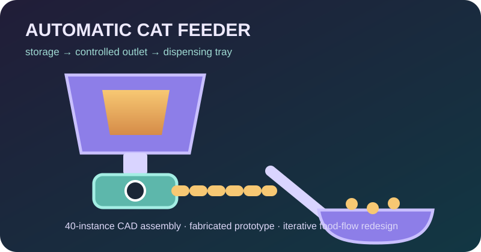
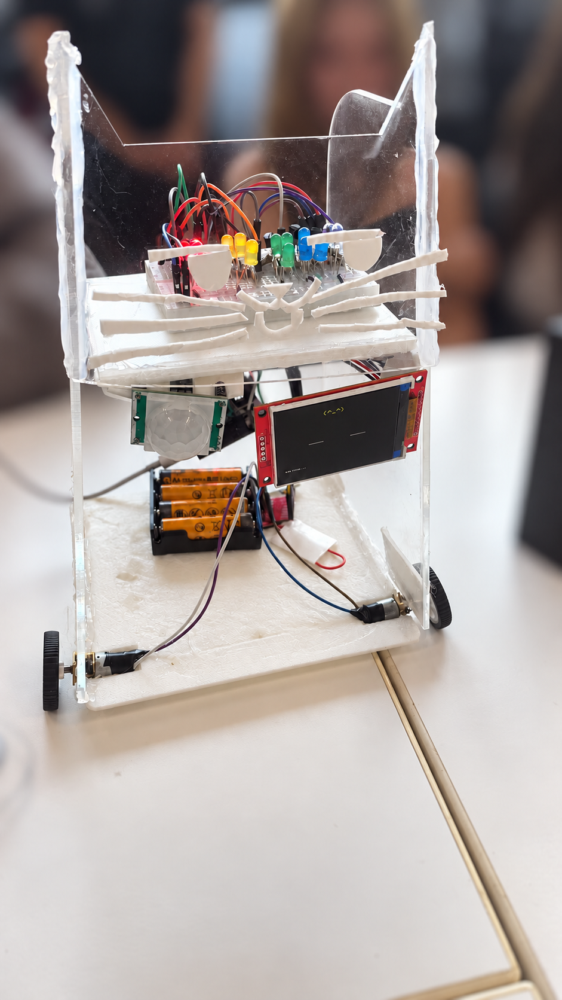
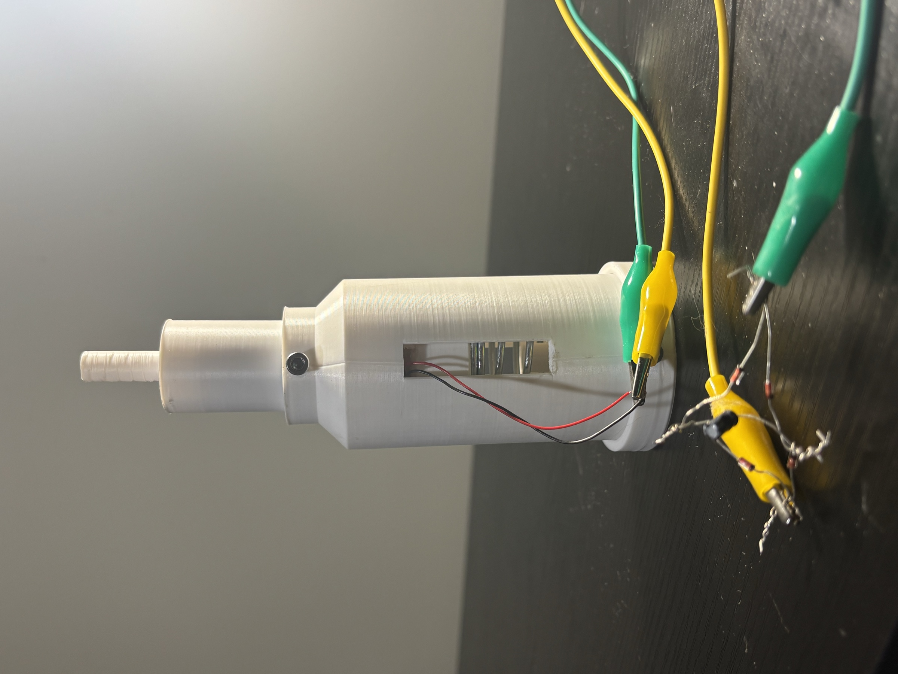
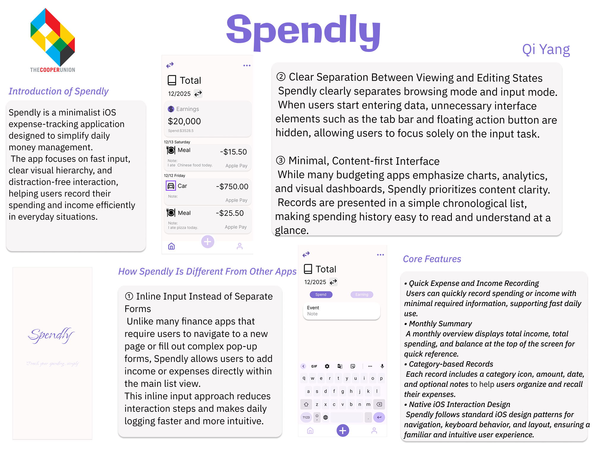
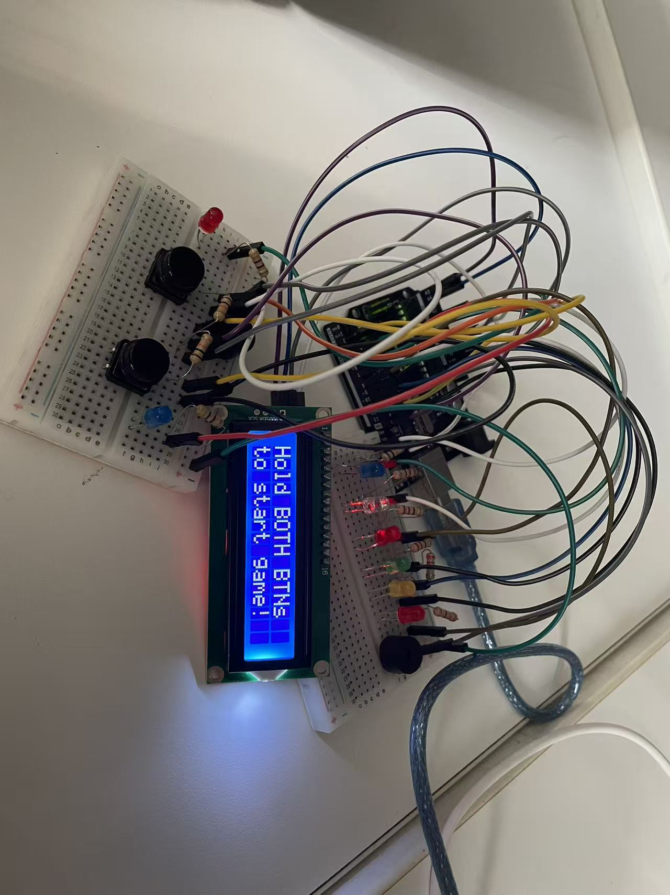
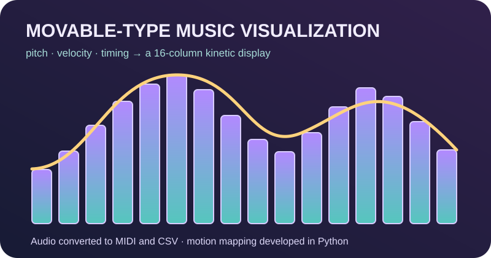

# Hi, I'm Shuoqi Yang! (˶ᵔ ᵕ ᵔ˶)

### Mechanical Engineering · Embedded Systems · Human-Centered Design

[Projects](#-selected-projects) · [Skills](#-skills--tools) · [Current Focus](#-current-focus) · [Contact](#-contact)

---

## About Me

I am a high school student in New York who enjoys turning ideas into testable prototypes through **CAD, fabrication, electronics, and code**. I am especially interested in the point where mechanical systems and software meet—and in improving designs when physical testing reveals problems that a model cannot predict.

I am also a co-founder and the **Mechanical Engineering Lead of Alba Studio**, a four-person student STEM studio developing energy and cat-technology prototypes.

## ✦ Selected Projects

<table>
  <tr>
    <td width="50%" valign="top">
      

      <h3>🐾 <a href="https://github.com/147y111/Automatic-Cat-Feeder">Automatic Cat Feeder</a></h3>
      Created a 40-instance CAD assembly, fabricated and assembled the structure, and redesigned the food outlet after diagnosing dispensing jams.
    </td>
    <td width="50%" valign="top">
      

      <h3>🐱 <a href="https://github.com/147y111/ESP32-MewGlow">ESP32 MewGlow</a></h3>
      Developed an expressive mobile cat companion using an ESP32, LEDs, a TFT display, sensors, motors, and a SwiftUI control app.
    </td>
  </tr>
  <tr>
    <td width="50%" valign="top">
      

      <h3>⚡ <a href="https://github.com/147y111/piezoelectric-floor-tile">Piezoelectric Floor Tile</a></h3>
      Helped build and test an energy-harvesting floor tile, recorded stepping data, contributed to CAD, and supported physical-model calibration.
    </td>
    <td width="50%" valign="top">
      

      <h3>💜 <a href="https://github.com/147y111/Spendly">Spendly</a></h3>
      Built a SwiftUI personal-finance app with transaction entry, category management, data visualization, and an interface designed in Figma.
    </td>
  </tr>
  <tr>
    <td width="50%" valign="top">
      

      <h3>🎮 <a href="https://github.com/147y111/Reaction-Time-Game">Reaction Time Game</a></h3>
      Co-developed an Arduino game through circuit assembly, wiring, physical integration, debugging, and iterative difficulty improvements.
    </td>
    <td width="50%" valign="top">
      

      <h3>🎵 <a href="https://github.com/147y111/Movable-Type-Music-Visualization">Music Visualization</a></h3>
      Converted audio into MIDI and CSV data and mapped pitch, velocity, and timing across a planned 16-column kinetic display.
    </td>
  </tr>
</table>

## ✦ Skills & Tools

| Area | Experience |
| --- | --- |
| **Mechanical Design** | SolidWorks, Onshape, CAD assemblies, mechanism design, dimensional planning, fabrication, and assembly |
| **Embedded Systems** | Arduino Uno, ESP32, sensors, LEDs, TFT displays, servo and motor control, breadboarding, soldering, and debugging |
| **Programming** | C/C++, Python, Swift, and SwiftUI |
| **Design & Development** | Xcode, Arduino IDE, VS Code, Figma, Git, and GitHub |
| **Engineering Practice** | Physical testing, failure analysis, design iteration, technical documentation, and collaboration |

## ✦ Current Focus

I am exploring projects that connect **mechanical systems, electronics, and software**, with particular interest in energy harvesting, accessible interfaces, assistive devices, and practical products shaped by real user needs.

## ✦ Contact

- GitHub: [@147y111](https://github.com/147y111)
- Email: [shuoqiyang15@gmail.com](mailto:shuoqiyang15@gmail.com)

---

### Building, testing, and learning—one prototype at a time. ᕙ( •̀ ᗜ •́ )ᕗ

